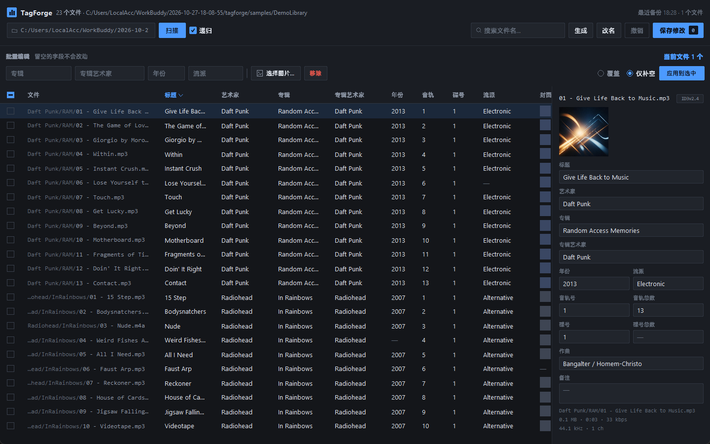
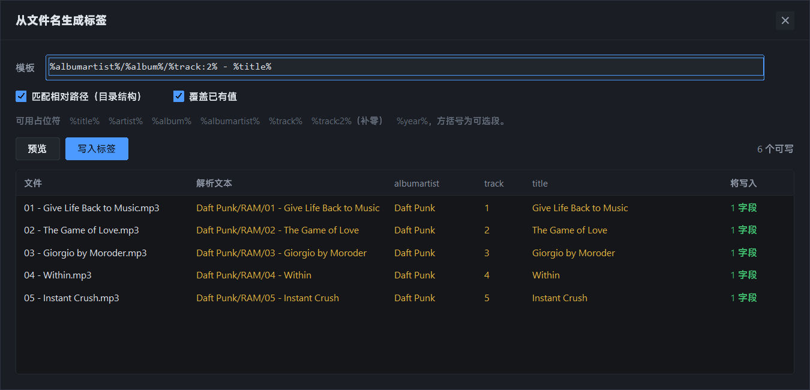
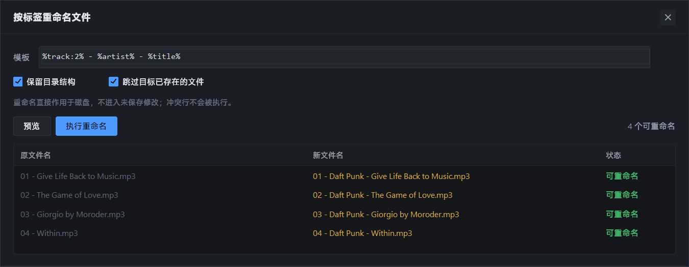

# TagForge

一个 Mp3tag 风格的多格式音频标签管理器：**Windows 桌面应用**（Tkinter），
表格化批量编辑、跨格式字段统一、从文件名/目录结构反解标签、按标签重命名，
批量写入带快照回滚。


---

## 快速开始

```bat
:: 双击即可（自动挑选带 tkinter 的 Python）
run.bat

:: 指定启动目录 / 强制缩放
run.bat "D:\Music"
run.bat "D:\Music" --scale 1.25
```

依赖只有两个：**Python 3.10+（带 tkinter）** 和 **mutagen**。
首次使用若提示缺依赖：

```bat
python -m venv .venv
.venv\Scripts\pip install mutagen
```

---

## 界面

| 主界面 | 从文件名生成标签 |
|---|---|
|  |  |

| 按标签重命名 | 撤销确认 |
|---|---|
|  |  |

四个常驻区：**命令区 / 批量操作条 / 主表格 / 详情面板**，模板类操作走
「参数 → 预览 → 执行」三段式浮层。

## 功能

**单文件**
- 表格单击单元格即进入编辑（Enter 提交 / Tab 横向移动 / Esc 取消）
- 改动先进入暂存，点击「保存修改」（或 Ctrl+S）才写盘
- 右侧详情：12 个字段 + 封面大图 + 时长 / 码率 / 采样率 / 声道 / 标签版本

**批量**
- 勾选多个文件 → 统一「专辑 / 专辑艺术家 / 年份 / 流派 / 封面」
- 两种模式：**覆盖** 与 **仅补空**（只填空白，不动已有值）
- 只写填了内容的字段，其余标签帧原样保留

**模板**
- 从文件名或目录结构反解：`%albumartist%/%album%/%track:2% - %title%`
- 支持 `%track:2%` 补零、`[...]` 可选段、`%_filename%` 等虚拟字段
- 先 dry-run 预览，确认后才写；写入按钮在预览前不可用
- 按标签重命名：默认保留目录结构，冲突行不执行

**安全**
- 每次写盘前自动快照（字段 + 封面字节）到 `~/.tagforge/backups/`
- 单文件失败即时回滚，其余继续，失败清单精确到文件
- 「撤销」整批回退上一次操作，与未保存修改互不干扰

## 支持格式

| 标签体系 | 扩展名 |
|---|---|
| ID3v2.3 / 2.4 | `.mp3` `.wav` `.aiff` `.aif` `.dsf` |
| Vorbis Comments | `.flac` `.ogg` `.oga` `.opus` |
| iTunes atoms | `.m4a` `.m4b` `.mp4` `.m4v` |
| APEv2 | `.ape` `.wv` `.mpc` |

## DPI 与字体

- **全部坐标以 1440×900 的设计单位书写**，绘制时统一乘以 `SCALE`；
  字号同样按倍率换算，因此 125% / 150% / 200% 下版式完全等比，不会出现"字大框小"。
- 启动时用 `GetDpiForSystem()` 读取系统 DPI 换算缩放倍率；
  若窗口会超出屏幕则自动逐档回退；也可用 `--scale` 或环境变量 `TAGFORGE_SCALE` 覆盖。
- 字体：使用**系统默认 UI 字体**（Tk 的 `TkDefaultFont` 字族，Windows 上即 Segoe UI，
  中文由系统字体链接自动回退到微软雅黑一类字形），不随包字体，换机器自动跟随系统；
  文件列与技术信息使用等宽 Consolas。

## 代码结构

```
tagforge/
├─ tagforge/
│  ├─ gui.py         桌面端：Painter 绘制层 + 主窗口 + 三个浮层（Tkinter）
│  ├─ fields.py      统一字段模型（canonical schema），格式差异的唯一边界
│  ├─ adapters.py    四种写入引擎 + 封面读写 + 技术信息探测
│  ├─ naming.py      文件名 ⇄ 标签 双向模板引擎
│  └─ library.py     扫描 / 批量写入 / 快照回滚 / 撤销 / 重命名
├─ tests/            演示库生成 + 后端流程测试 + GUI 端到端测试
└─ samples/          测试音频（DemoLibrary 为 23 曲演示库）
```

设计要点：格式差异只出现在 `fields.py` 的映射表与 `adapters.py`；
`gui.py` 只认识 13 个 canonical 字段，因此批量编辑、模板、重命名都不需要为格式写分支。

## 测试

```bat
python tests/make_demo.py    :: 生成 23 曲演示库（需要 ffmpeg）
python tests/test_flow.py    :: 后端：40 项
python tests/test_gui.py     :: 桌面端：25 项（扫描/编辑/保存/批量/撤销/排序/过滤）
```

文档：
- `docs/research-and-plan.md` —— 调研结论、功能范围、实现方案
- `docs/architecture.md` —— 模块层级、调用关系与数据流
- `docs/gui-spec.md` —— GUI 设计规格（信息架构、区域规格、状态模型、评审清单）
