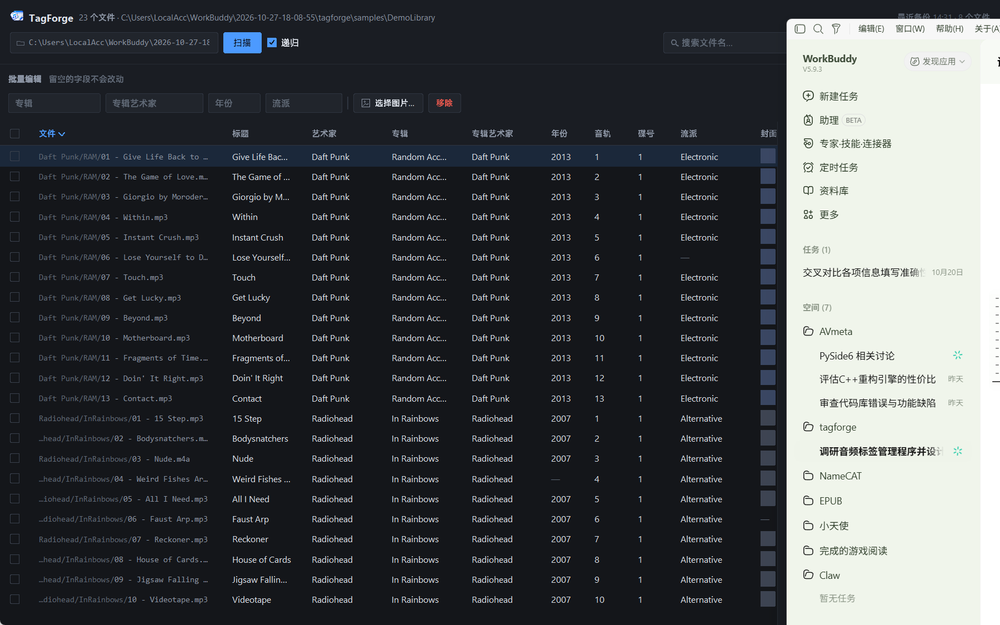

# TagForge


一个 Mp3tag 风格的**多格式音频标签管理器**，Windows 桌面应用（Python + Tkinter）。

表格化批量编辑、跨格式字段统一、从文件名 / 目录结构反解标签、按标签重命名，
写盘前自动快照，可整批撤销。免安装单文件 exe，双击即用。

当前版本 **1.0.0** · [下载](#下载) · [功能](#功能) · [快捷键](#快捷键) · [源码运行](#从源码运行)

---

## 下载

到 [Releases](https://github.com/Utpop/tagforge/releases/latest) 下载 `TagForge.exe`（约 14 MB，单文件免安装）。

双击运行 → 点左上角「扫描」选择音乐目录。

> 首次启动列表为空是正常的：TagForge 不建库、不索引，只处理你当场选择的目录。
> 支持把目录作为参数拖到 exe 上，或命令行 `TagForge.exe "D:\Music"`。

系统要求：Windows 10 / 11 64 位。不需要安装 Python。

---

## 截图


| 从文件名生成标签 | 按标签重命名 |
|---|---|
|  |  |

| 撤销确认 | 高 DPI（125%） |
|---|---|
|  |  |

界面分四个常驻区：**命令区 / 批量操作条 / 主表格 / 详情面板**。
模板类操作一律走「参数 → 预览 → 执行」三段式浮层，预览前写入按钮不可用。

---

## 功能

### 浏览与单文件编辑

- 选目录即扫描，递归开关，按路径 / 标题 / 艺术家 / 专辑 / 年份 / 流派 / 作曲 / 音轨 / 碟号 / 备注过滤
- 点表头排序，数值列（年份 / 音轨 / 碟号）按数值排，缺值行置顶
- 单击单元格直接编辑：`Enter` 提交、`Tab` 跳下一格、`Esc` 取消
- 右侧详情面板同步可编辑，与表格共用同一份暂存
- 改动先进入暂存（脏值显示为琥珀色），点「保存修改」或 `Ctrl+S` 才写盘
- 清空单元格 = 删除该字段；"待删除"以琥珀色 `—` 标示，与"从未填过"区分
- 详情面板显示封面、时长、码率、采样率、声道与**真实** ID3 版本（v2.3 / v2.4）

### 批量

- 勾选多个文件，统一设置「专辑 / 专辑艺术家 / 年份 / 流派 / 封面」
- 两种模式：**覆盖**（改写已有值）与**仅补空**（只填空字段，不动已有值）
- 批量条常驻，始终显示本次作用到几个文件
- **只写填了内容的字段**，其余标签帧一律不碰：
  - 换封面只替换正面封面（`type=3`），封底、艺人照等其它图片帧保留
  - 换备注只替换「英文 + 无描述」那一槽，其它语言备注保留
  - 音轨 / 碟号按 `n/m` 合并存储，不会顺手清掉总数
- 若还有未保存的单元格改动，批量前会先确认，不会静默丢弃

### 从文件名 / 目录结构生成标签

- 同一套模板双向使用：`%albumartist%/%album%/%track:2% - %title%`
- 支持 `%track:2%` 补零、`[...]` 可选段、`%_filename%` 等虚拟字段
- 先 dry-run 预览：逐行显示解析结果、将写入的字段数、解析失败的具体原因
- 模板不含 `/` 却勾了「匹配相对路径」时，直接判为解析失败——
  否则目录前缀会被正则吞进第一个字段（例如写成音轨号）
- 预览后改动模板或选项，写入按钮立即失效，必须重新预览

### 按标签重命名

- 默认保留目录结构，只改文件名；取消勾选时模板里的 `/` 会生成子目录
- 冲突检测：目标已存在、与同批文件撞名、目标不在库目录内都会标红并跳过
- 支持整批互换编号（`01 ↔ 02`）：目标被同批文件占用时自动走临时名两阶段改名
- 「跳过目标已存在的文件」可取消，取消后对同名文件执行覆盖

### 安全

- 每次写盘前自动快照（字段 + 多值原貌 + 封面字节）到 `~/.tagforge/backups/`，保留最近 50 条
- 单文件失败即时回滚，其余继续；失败清单精确到文件名与原因
- 编辑后文件被外部删除 / 重命名，会在保存时明确列为「文件已不存在」，而不是静默丢弃
- 「撤销」整批回退，**撤销本身也留快照**，所以撤销可以再撤销
- 已撤销的备份不会重复回退；连点撤销会继续往前回退
- 快照读取失败的文件在撤销时被跳过，绝不会被当成"字段为空"而清空标签
- 撤销不会丢弃你尚未保存的修改

---

## 快捷键

| 按键 | 作用 |
|---|---|
| `Enter` | 提交当前单元格 |
| `Tab` / `Shift+Tab` | 提交并跳到下 / 上一格（到行尾自动换行） |
| `Esc` | 取消当前编辑 |
| `Ctrl+S` | 保存所有暂存改动 |
| 鼠标滚轮 | 表格滚动；模板预览表里翻页 |

路径框输入目录后按 `Enter` 直接扫描。

---

## 支持格式

| 标签体系 | 扩展名 |
|---|---|
| ID3v2.3 / v2.4 | `.mp3` `.wav` `.aiff` `.aif` `.aifc` `.dsf` |
| Vorbis Comments（+ FLAC Picture） | `.flac` `.ogg` `.oga` `.opus` |
| iTunes atoms | `.m4a` `.m4b` `.mp4` `.m4v` |
| APEv2 | `.ape` `.wv` `.mpc` |

统一字段 13 个：标题、艺术家、专辑、专辑艺术家、年份、音轨号、音轨总数、
碟号、碟号总数、流派、作曲、备注、封面。

四套引擎在字段支持上保持一致：`n/m` 音轨号双向拆分、多值字段（艺术家 / 流派 / 作曲）、
只填总数、封面替换都按同一语义处理。

---

## 从源码运行

依赖只有两个：**Python 3.10+（带 tkinter）** 和 **mutagen**。

```bat
python -m venv .venv
.venv\Scripts\pip install mutagen

:: 双击启动（自动挑选带 tkinter 的 Python）
run.bat

:: 指定目录 / 强制缩放
run.bat "D:\Music"
run.bat "D:\Music" --scale 1.25
```

也可以直接 `python -m tagforge.gui "D:\Music"`。

---

## 高 DPI、字体与图标

- **所有坐标按 1440×900 的设计单位书写**，绘制时统一乘 `SCALE`；字号同样换算。
  因此 100% / 125% / 150% / 200% 下版式完全等比，不会"字大框小"。
- 缩放倍率由 `GetDpiForSystem()` 推出；窗口可能超出屏幕时逐档回退；
  也可用 `--scale` 或环境变量 `TAGFORGE_SCALE` 覆盖。
- 字体使用**系统默认 UI 字体**（Tk 的 `TkDefaultFont`，Windows 上即 Segoe UI，
  中文由系统字体链接回退到微软雅黑一类字形），不随包字体；文件列与技术信息用 Consolas。
- 图标由 `assets/app_icon_src.jpg` 生成，`tools/make_icon.py` 会去掉白底、
  输出多尺寸 PNG 与多分辨率 `.ico`。
  标题栏与任务栏图标走 Win32 `WM_SETICON`（Tk 9 的 `iconbitmap` 在 Windows 上不生效），
  并设置 `AppUserModelID` 让任务栏正确分组。

---

## 项目结构

```
tagforge/
├─ tagforge/
│  ├─ gui.py        桌面端：Painter 绘制层 + 主窗口 + 三个浮层（Tkinter）
│  ├─ fields.py     统一字段模型（canonical schema），格式差异的唯一边界
│  ├─ adapters.py   四种写入引擎 + 封面读写 + 多值原貌读取 + 技术信息探测
│  ├─ naming.py     文件名 ⇄ 标签 双向模板引擎
│  └─ library.py    扫描 / 批量写入 / 快照回滚 / 撤销 / 重命名
├─ assets/          图标（源图 + 多尺寸 PNG + ICO）
├─ tools/           图标生成、PyInstaller 入口
├─ tests/           演示库生成 + 后端流程 + GUI 端到端 + 回归探针
├─ samples/         测试音频（DemoLibrary 为 23 曲演示库）
└─ docs/            调研、架构、GUI 规格、审查报告、截图
```

依赖方向严格单向：`gui → library → naming / fields → adapters → mutagen`。
格式差异只出现在 `fields.py` 的映射表与 `adapters.py`，`gui.py` 只认识 13 个 canonical 字段，
所以批量编辑、模板、重命名都不必为格式写分支。

---

## 设计取舍

- **文件即真相**：不建数据库、不索引。因此永远看不到"别的软件改了标签，库里还是旧的"。
- **写盘是显式动作**：单元格编辑只进暂存，必须点保存。界面上不存在逐键自动保存。
- **增量写入**：patch 里没有的字段绝不触碰。批量改专辑不会抹掉歌词、ReplayGain、自定义帧。
- **失败是列表不是异常**：一个文件写失败不影响其它文件，界面按文件报告结果。
- **ID3v2.3 不支持真正的多值**（规范用 `/` 分隔，会与 `AC/DC` 这类名字冲突），
  所以 v2.3 文件的多值会合并成一个值保存，保证往返语义不变；需要真多值请转 v2.4。
- **备份只保留 50 条**：磁盘占用与回溯深度之间的折中，可改 `library.MAX_BACKUPS`。

---

## 测试

```bat
python tests/make_demo.py      :: 生成 23 曲演示库（需要 ffmpeg）
python tests/test_flow.py      :: 后端流程：40 项
python tests/test_gui.py       :: 桌面端：35 项（在临时副本上跑，不改动仓库样例）
python tests/review_probe.py   :: 回归探针：37 项（帧级保留、跨引擎对称、快照安全、状态一致性）
```

三套全部通过；`review_probe.py` 退出码非 0 即表示有回归，可直接接进 CI。

---

## 打包 exe

```bat
pip install pyinstaller pillow
python tools/make_icon.py                       :: 重新生成图标
pyinstaller --noconfirm --clean --onefile --windowed --name TagForge ^
  --icon assets/app_icon.ico --add-data "assets;assets" ^
  --paths . --exclude-module PIL --exclude-module numpy tools/entry.py
```

产物在 `dist/TagForge.exe`。`PIL` 只用于生成图标，运行时不依赖；
若目标机器装了 Pillow，程序会自动用它显示 JPEG 封面（未装时 JPEG 封面显示为占位块，
PNG 封面不受影响）。

---

## 文档

- [docs/architecture.md](docs/architecture.md) —— 模块层级、调用关系、数据流、状态机
- [docs/gui-spec.md](docs/gui-spec.md) —— GUI 设计规格（信息架构、区域规格、评审清单）
- [docs/research-and-plan.md](docs/research-and-plan.md) —— 同类项目调研、功能范围、技术选型
- [docs/review-2026-11-03.md](docs/review-2026-11-03.md) —— 功能有效性与一致性审查（42 项缺陷、修复记录）

---

## 已知限制

- 只支持 Windows（DPI 与图标用到 Win32 API）。
- 不做转码、播放、在线元数据匹配（MusicBrainz / AcoustID）、CUE 分轨。
- 单次扫描上限 20000 个文件，超出会在顶栏提示"已达扫描上限"。
- 撤销以"批次"为单位，没有逐条命令历史。
